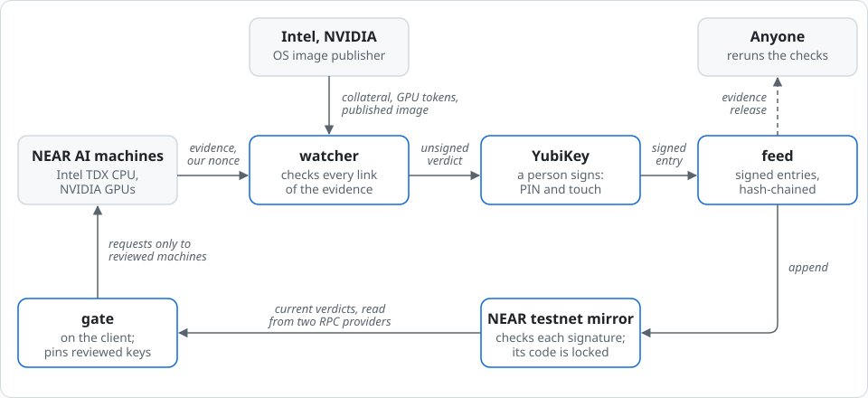
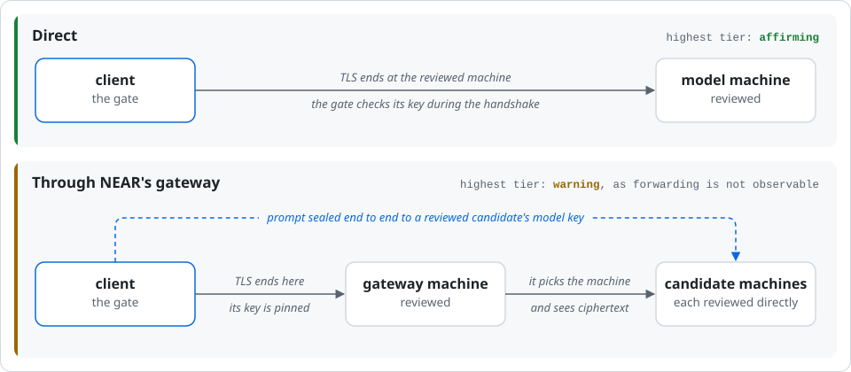

# Countersign

Confidential AI asks you to trust that the provider's hardware runs the code it claims, and the provider
usually issues that evidence itself. A receipt proves afterwards what a machine signed; Countersign decides
beforehand whether to send your prompt, on a review signed by someone other than the provider:

- **Held to what was published.** Besides the Intel TDX quote and NVIDIA's GPU attestation (fresh for our
  nonce, though NVIDIA's evidence is not bound to a machine; see
  [METHOD.md](METHOD.md#what-a-verdict-does-not-say)), the watcher recomputes the boot measurements
  (MRTD, RTMR0–2) from the published OS image, so a machine is checked against the image its provider
  published, not only against the event log it reports, and it judges Intel's rating of the platform's
  patch level (TCB status). It also replays the event log and checks the app's compose, the launcher log,
  and the TLS and OHTTP keys.
- **Signed by someone other than the provider.** Each review is an entry in a hash-chained feed, signed by a
  person on a YubiKey that attests it generated the key, and mirrored to a NEAR testnet contract that checks
  every signature itself and has no access keys, so nobody can change it.
- **Acted on before the request.** The gate reads the current verdict from two RPC providers and refuses the
  TLS connection to any machine it did not review, so no request byte reaches one. Through NEAR's gateway it
  also encrypts the prompt end to end to a reviewed model key.
- **A verdict says why.** Every check that does not pass carries its reason. For a `warning` verdict,
  `watcher ask --accept warning` lists each reason before anything is sent; without the flag the gate refuses.
- **Readable by other contracts.** The mirror answers `hosts` and `latest(host)` with each host's current
  verdict, so a NEAR contract or app can act on the same review.
- **Rerunnable by anyone.** The evidence behind each entry is published with it, and a public check compares
  the feed with its mirror every day.

What each check requires, how checks become a verdict, and what a verdict does not cover:
[METHOD.md](METHOD.md). The watcher reviews any model NEAR AI serves in a TEE, reached directly or through
NEAR's gateway (`--host`, `--model`); the feed covers one so far, GLM 5.3 Flash, by both routes. This
repository is our entry in the NEAR hackathon (tracks: Privacy & Private AI, AI Security & Defense). NEAR, a
provider the feed reviews, pays the hackathon's prizes; see [Independence](METHOD.md#independence). For
coding agents: [AGENTS.md](AGENTS.md). Countersign is the project's name; `sealed-review` is its
repository, its NEAR accounts and its policy id. A 15-second recording of the gate: [See it run](#see-it-run).

Licensed under the [Apache License 2.0](LICENSE).

## Check it without an API key

```sh
cargo build --release -p watcher
cargo test -p watcher
alias watcher=target/release/watcher
watcher verify --feed feed --key feed-public-a.pem --key feed-public-b.pem
watcher mirror --contract sealed-review-feed.testnet --feed feed --key feed-public-a.pem --key feed-public-b.pem
watcher gate --contract sealed-review-feed.testnet --key feed-public-a.pem --key feed-public-b.pem
cargo test -p watcher nothing_is_sent_to_an_unreviewed_machine
```

See: the build needs crates.io once; the tests and `verify` run without network. `verify` prints the current
verdict per host and fails if one byte of any entry changes. `mirror` and `gate` only read NEAR testnet, from
two public RPC providers, with no account or key: `mirror` prints `"ok": true` when the contract confirms the
feed, and `gate` prints the machines a request may go to, or exits with status 1 and `refused: …` giving
every reason, which is the gate working. The last test starts a local server the verdict did not review and
shows that the gate sends it nothing. Steps 2 to 7 below cover the rest; only `watcher ask` needs a NEAR AI
API key.

Measured on a clean clone (2026-11-09, 4 build jobs on an 8-core machine, crates not yet downloaded): the build
5 min 41 s, the tests 49 s, `mirror` and `gate` about 6.5 s each, `verify` and the last test under a second;
about 7 minutes in all, nearly all of it the first build.

## The cycle



The watcher reviews each machine it reaches, with evidence the provider cannot vouch for alone; a person
signs the result on a hardware key; the signed feed is mirrored to a contract nobody can change; and a client
acts on it on its own machine. Steps 2 to 5 below run each part.

## The two routes



Directly, the gate checks the TLS key of the machine that answers, so the prompt reaches only a reviewed
machine. Through the gateway, TLS ends at the gateway machine, and no client can see where it forwards the
request; so the gate also encrypts the prompt end to end to the model key of a reviewed candidate, and refuses
an answer that does not decrypt. The gateway still sees which model is asked, the sizes and the timing.

## Why an independent review

A confidential-AI provider usually runs the hardware and also issues the evidence that the hardware runs
the code it claims, so its users take the provider's word for it. Sweden's data protection authority
describes this in its final report on trusted execution environments ([IMY-2026-5444](https://www.imy.se/en/publications/betrodda-exekveringsmiljoer-for-uppkopplade-fordon/),
section 3.3.1): in conventional cloud set-ups "users of the environment must largely rely on the provider's
own assurances and security guarantees"; the attestation function "could also be organised through an
independent third party", which "could further strengthen the independence of the function"; and "[t]he
more frequently attestations are performed, the more rapidly any deviations affecting the integrity of
the system can be detected". Countersign is such a third party for NEAR AI: it checks every machine its
repeated fetches reach, publishes the results signed, and lets a client act on them on its own machine.
The report comes from IMY's data protection innovation sandbox with Volvo Group, CanaryBit and Ericsson, on
trucks' camera and sensor data rather than AI, and is guidance, not a ruling; its English text is an
automatic translation, and the Swedish version applies.

## Who it's for

- **Apps built on NEAR AI that promise their users privacy:** they can refuse to send a prompt unless a
  current verdict passes, without building and maintaining a verifier of their own.
- **Organisations with data-protection duties:** they get evidence about the provider from someone other
  than the provider, as IMY's report suggests.
- **NEAR contracts and agents that act on AI output:** they can read the same verdict onchain with
  `latest(host)` before relying on a provider's answer.
- **Providers:** they can point to an independent review that expires, rather than to their own word.

## Related work

Other tools check NEAR AI's attestation, and some go further in places. Brave's
[near-verifier](https://github.com/brave/near-verifier) checks the gateway and each model machine against a
reviewed dstack release and rebuilds NEAR's own images from source to check their provenance;
[teep](https://github.com/13rac1/teep) checks measurements against allowlists, judges Intel's TCB status and
binds TLS, for NEAR and other providers. Both tell the person running them whether a provider is fine at that
moment.

[Private Inference Beat](https://github.com/amiller/awesome-private-inference) compares private-inference
routes across providers, NEAR's included, and keeps dated reference values and the evidence behind each
assessment; its assessments are preliminary, award no stage and carry no append-only guarantee. Dstack's
[Private AI Gateway](https://github.com/Dstack-TEE/private-ai-gateway) verifies a fresh report and pins TLS
before each request, as the gate here does, for providers that follow dstack's Attested Confidential
Inference (ACI) specification; whether to accept the software a report names, it leaves to the user.

What Countersign adds is the answer to that last question, given once for every client by someone other than
the provider: a verdict on what each machine runs, with the reason for every check that does not pass, signed
on a hardware key, that expires, kept in a NEAR contract nobody can change, and enforced by a gate before a
prompt leaves. The watcher computes the expected boot measurements from the published OS image itself. A
verdict could cite another tool's result, a rebuild or a recorded reference value for instance, as one of its
reasons.

## What you need

- Rust 1.92 or later for the watcher; Rust 1.99.1 for the mirror contract (pinned in
  `mirror/rust-toolchain.toml`, installed by rustup on first use).
- Network access to the model endpoint, NEAR's endpoint registry (`completions.near.ai`), NEAR's gateway (`cloud-api.near.ai`), Intel's PCS, NVIDIA's attestation service, GitHub (for the dstack
  OS image) and the two NEAR testnet RPC providers named below.

## 1. Build and test

```sh
cargo build --release -p watcher
cargo test -p watcher
```

See: the binary at `target/release/watcher`; every test passes without network access.

## 2. Review the live endpoint

```sh
alias watcher=target/release/watcher
watcher fetch --out near
```

See: one line per machine reached (its TLS key, then `ok` or what is missing), then a summary such as
`1 machine(s) in 5 fetch(es): 1 new, 0 seen again; 0 kept from earlier sweeps, 0 dropped (24 h old); 1 machine(s) in near`.
Fetching stops after 4 fetches in a row reach no new machine. Each machine's evidence is saved as
`near/machine-N.json`. Running `fetch` again refreshes the machines it reaches again (`seen again`) and
adds new ones; evidence 24 hours old drops out. Without `--host`, `fetch` reviews GLM 5.3 Flash's direct
endpoint, `glm-5-3-flash.completions.near.ai`, the only model this repository's feed covers;
`--host <model host>` reviews another model NEAR AI serves in a TEE, from the hosts NEAR's registry
(`completions.near.ai/endpoints`) lists.

```sh
watcher image near/machine-1.json
watcher check near/machine-1.json
```

See: the published dstack OS image fetched into `~/.cache/sealed-review/images`, checked against the hash
the report declares; then the review as JSON. It contains the release's facts, one entry per check, each
with its link of the chain, its status (`pass`, `warn`, `fail`, `unknown`) and the reason, and the overall
`tier` (`affirming`, `warning`, `contraindicated` or `none`).

```sh
cp near/machine-1.json near/before.json
watcher fetch --out near
watcher diff near/before.json near/machine-1.json
```

See: what differs between two saved bundles (facts, check statuses, tier, launcher log) and whether they
are the same instance. Any two bundles of one endpoint work: two machines of one sweep, or a copy kept
from an earlier sweep and the same machine fetched again after a new release.

## 2b. Review the route through NEAR's gateway

```sh
watcher gateway fetch --out gateway.json
watcher gateway image gateway.json
watcher gateway check gateway.json --direct near
```

See: `<instance>: N candidate machine(s); saved gateway.json`, then the OS images of the gateway and of
each candidate, then the route's review as JSON: the gateway machine's checks, each candidate's, and the
route's own two checks. The route is at most `warning`, because no client can see which machine the gateway
forwards to (`forwarding_observable`). Each candidate must be a machine the direct sweep in `near` reached
within 24 hours (`reached_directly`). A candidate the sweep did not reach makes its check `unknown` and the
route `none`, which the gate refuses. Since 13 Nov NEAR's gateway reports every machine it may forward to;
one of them serves NEAR's long-context host, `glm-5-3-flash-long.completions.near.ai`, which `fetch` does not
sweep, so entry 12 is `none`. Accepting a sweep of each host that serves the model is planned.
`gateway fetch --model <model id>` reviews the route for another model (the default is
`z-ai/glm-5.3-flash`); `--direct` then names a direct sweep of that same model.

## 3. Verify the signed feed

The feed has two public keys, `feed-public-a.pem` and `feed-public-b.pem`, each generated on its own
YubiKey; key A signs, key B is kept offline. Entries are `feed/000001.jwt`, `feed/000002.jwt`, …, each an
EAT Attestation Result (EAR) signed ES256 by one of the keys and chained to the previous entry by its SHA-256.
If a YubiKey is lost, the other key signs an entry that retires its key; entries signed by a retired key
are refused from then on.

Each YubiKey attests its key: a certificate saying the key was generated inside it, signed by a key Yubico
put in the YubiKey at the factory (`feed-attestation-f9-a.pem`), which chains to Yubico's root.

```sh
curl -sSO https://developers.yubico.com/PKI/yubico-ca-1.pem
curl -sSO https://developers.yubico.com/PKI/yubico-intermediate.pem
for k in a b; do
  cat feed-attestation-f9-$k.pem yubico-intermediate.pem > chain-$k.pem
  openssl verify -CAfile yubico-ca-1.pem -untrusted chain-$k.pem feed-attestation-$k.pem
  openssl x509 -in feed-attestation-$k.pem -noout -pubkey | diff - feed-public-$k.pem && echo "key $k: same key"
  openssl asn1parse -in feed-attestation-$k.pem | grep -A1 '41482\.3\.8' | tail -1
done
```

See: `OK` for each attestation, `same key`, and `0302`: the YubiKey asks for the PIN (03) and a touch (02)
before every signature. Each attestation also records its YubiKey's firmware (`41482.3.3`) and serial
number (`41482.3.7`); the two serial numbers differ, so the keys are on two devices.

```sh
watcher verify --feed feed --key feed-public-a.pem --key feed-public-b.pem
```

See: the current verdict per host as JSON, with its sequence number, status, expiry, any correction and
the TLS keys of the machines it reviewed. The gateway route is named `cloud-api.near.ai/z-ai/glm-5.3-flash`;
its only TLS key is the gateway machine's, and its `model_keys` are the candidates' keys a request may be
encrypted to. `keys` lists both keys and the entry that retired a key, if any. Changing one byte of any
entry makes `verify` fail.

## 3b. Rerun the review behind an entry

Each entry's evidence is attached to the release `feed-<seq>`, six digits, as the entry's file is named:
the bundles `watcher fetch` saved (and `gateway.json` for the gateway route), with their SHA-256 sums.

```sh
seq=000001
base=https://github.com/greenlima/sealed-review/releases/download/feed-$seq
curl -sSL -O $base/evidence-$seq.tar.gz -O $base/SHA256SUMS
sha256sum -c SHA256SUMS
mkdir -p evidence/$seq && tar -xzf evidence-$seq.tar.gz -C evidence/$seq
watcher check evidence/$seq/near/machine-1.json | jq '{tier, open: [.checks[] | select(.status != "pass") | .id]}'
jq -R 'split(".")[1] | gsub("-";"+") | gsub("_";"/") | @base64d | fromjson
  | [.submods[] | {nonce: .eat_nonce, fetched_at: .ear_verifier_claims.fetched_at}]' feed/$seq.jwt
jq -c '{nonce, fetched_at}' evidence/$seq/near/machine-*.json
```

See: `OK` for each file; the review of each machine, with the tier and checks the entry records for it;
and every nonce and fetch time in the entry found in a bundle. Intel's signature on the quote covers the
nonce, so the bundle is the evidence the signed entry rests on. For a gateway entry, the entry's nonce and
fetch time are the gateway fetch's, in `gateway.json`; the `near/` bundles are the direct sweep its candidates
are checked against:

```sh
watcher gateway check evidence/$seq/gateway.json --direct evidence/$seq/near
jq -c '{nonce, fetched_at}' evidence/$seq/gateway.json
```

## 4. Compare the feed with its NEAR testnet mirror

```sh
watcher mirror --contract sealed-review-feed.testnet --feed feed --key feed-public-a.pem --key feed-public-b.pem
```

See: the mirror read from `test.rpc.fastnear.com` and `archival-rpc.testnet.near.org` at one block height,
both providers agreeing, the contract locked (no access keys), holding the feed's two keys, and in sync with
`feed/`.

Steps 3 and 4 also run every day in public, in `.github/workflows/check.yml`, without secrets: a run fails
if an entry does not verify, the mirror does not confirm the feed, a current verdict expires within 24
hours, or a reviewed machine now runs another workload than its verdict recorded. That last check is
`watcher drift`, which you can run too:

```
watcher drift --feed feed --key feed-public-a.pem --key feed-public-b.pem
```

See: per host, each machine reached, as `unchanged`, `changed` (with each service that moved),
`unrecorded` (an entry from before workloads were recorded), `not_reviewed` (a machine no verdict covers,
which the gate refuses) or `not_reached`. See its runs under the repository's Actions tab.

## 5. Gate a request

```sh
watcher gate --contract sealed-review-feed.testnet --key feed-public-a.pem --key feed-public-b.pem
```

See: whether a request to the host may be sent, and to which machines. Only an unexpired `affirming`
verdict passes; `--accept warning` also lets `warning` through, and `open` lists every check of the
verdict that did not pass, with its reason (each check id is explained in [METHOD.md](METHOD.md)).

```sh
NEARAI_API_KEY=... watcher ask --contract sealed-review-feed.testnet --key feed-public-a.pem --key feed-public-b.pem --prompt "Hello"
```

See: with `--accept warning`, a table of each check the verdict did not pass, with its reason, before the
request is sent; then the TLS key of the machine that served it, and the model's answer between two rules (on
stdout, the answer alone; colour only on a terminal, and never with `NO_COLOR` set). The gate checks the server's key
during the TLS handshake, so no request byte reaches a machine the verdict did not review.

```sh
NEARAI_API_KEY=... watcher ask --contract sealed-review-feed.testnet --key feed-public-a.pem --key feed-public-b.pem --accept warning \
  --host cloud-api.near.ai/z-ai/glm-5.3-flash --prompt "Hello"
```

See: the same through the gateway, plus `end-to-end encrypted to model key …`. The prompt leaves your
machine encrypted to a reviewed model key, and an answer that does not decrypt to this request's key is
refused. What this does and does not hide: [METHOD.md](METHOD.md#what-passing-the-gate-means).

While the current gateway entry is `none` (entry 12, see step 2b), this stops at a refusal that begins
`refused: verdict 12 is "none"`: the gate refusing a route it could not fully review. The direct route above
is unaffected.

## 6. The mirror contract

```sh
cd mirror
cargo test
```

See: the contract's tests pass. The contract accepts an entry from anyone, but only if one of the two feed
keys signed it (low-S), that key is not retired, and the entry follows the current head.

Then check that the contract on testnet is this code. Its account has no keys left, so nobody can change it.
Ask it which commit it was built from, build that commit in the Docker image pinned by digest in
`mirror/Cargo.toml`, and compare the checksum with the deployed one:

```sh
rpc() { curl -s https://test.rpc.fastnear.com -H 'Content-Type: application/json' -d "$1"; }
rpc '{"jsonrpc":"2.0","id":1,"method":"query","params":{"request_type":"call_function","finality":"final","account_id":"sealed-review-feed.testnet","method_name":"contract_source_metadata","args_base64":"e30="}}' \
  | jq '.result.result | implode | fromjson | .build_info'
git checkout <rev from source_code_snapshot>
cargo near build reproducible-wasm
rpc '{"jsonrpc":"2.0","id":1,"method":"query","params":{"request_type":"view_account","finality":"final","account_id":"sealed-review-feed.testnet"}}' \
  | jq -r .result.code_hash
rpc '{"jsonrpc":"2.0","id":1,"method":"query","params":{"request_type":"view_access_key_list","finality":"final","account_id":"sealed-review-feed.testnet"}}' \
  | jq '.result.keys | length'
```

See: `build_info` names the image digest and `git+https://github.com/greenlima/sealed-review.git?rev=…`; the
build prints a `SHA-256 checksum bs58` equal to the deployed `code_hash`; and the account has `0` keys.

## 7. Side by side with NEAR's own SDK

```sh
cd compare
cargo run -- ../near/machine-1.json
```

See: NEAR's Rust SDK run on the same evidence as the watcher, on its defaults and on a strict policy, and
for each case whether the two agree.

## How it was built

All code in this repository was written during the hackathon, from 30 October 2026; no earlier code of
ours is reused. Main libraries: `dcap-qvl` (Intel TDX quote verification), `dstack-mr` and `dstack-types`
(dstack's measurement calculator and types), `rustls` and `reqwest` (TLS with the server's key checked
during the handshake), `ring`, `sha2`, `hkdf`, `chacha20poly1305` and `curve25519-dalek` (signatures,
hashes and NEAR's end-to-end encryption), `x509-cert` and `der` (the TLS certificate's key and NVIDIA's certificates), `near-sdk` (the
mirror contract), and `nearai-inference-sdk` (NEAR's own verifier, in `compare/` only). The full lists are
in each `Cargo.toml`, the exact versions in each `Cargo.lock`.

Written with AI coding assistants (Cursor); every change reviewed and tested by the author.

## See it run


Recorded on 10 Nov 2026, when the gateway route (entry 4) read `warning`; the current gateway entry reads
`none` ([step 2b](#2b-review-the-route-through-nears-gateway)).
